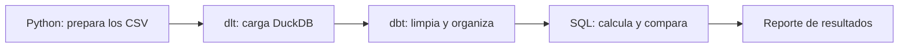

# El pipeline del minimercado

## Qué se preparó

La idea es seguir lo que pasa en un minimercado: qué productos se compran, cuáles se venden, cuánto queda en el depósito y qué ganancia dejan las ventas. Para eso se armó una simulación de 90 días, del 1 de enero al 31 de marzo de 2026. Los archivos contienen 20 productos, 5 vendedores, 108 compras, 801 líneas de venta y 909 movimientos de stock.

Los productos son habituales en un negocio de barrio: arroz, leche, yerba, aceite y artículos de limpieza. Los vendedores tienen nombres ficticios, como Fabricio Díaz y Camila Benítez. También se usaron nombres de comercios para los proveedores. Estos nombres sirven para leer los resultados con más facilidad; los identificadores numéricos mantienen las relaciones entre las tablas.

## Cómo funciona

Primero se generan los cinco CSV con una semilla fija, 2026. Esto permite volver a obtener los mismos datos. Después, dlt los carga en el esquema raw_minimercado de DuckDB. dbt toma esas tablas, organiza los datos y calcula los indicadores. Por último, se comparan los totales y se guarda un reporte JSON. Dagster conecta los cuatro pasos y permite ejecutarlos desde su interfaz o desde la terminal.

Las compras se reciben antes de vender durante cada día. El generador da más peso a algunos productos y aumenta la cantidad de operaciones los fines de semana. Cada compra genera una entrada de stock y cada venta una salida. Si quedan pocas unidades de un producto, la cantidad vendida se limita al saldo disponible. El stock inicial se suma una sola vez al reconstruir los movimientos.

## Cómo se organizaron las tablas

Se siguió la separación que muestran los materiales de clase: origen, staging, modelos intermedios y tablas de análisis. Staging conserva una tabla por archivo de origen y corrige tipos y nombres. Las fechas se guardan como fechas y los importes como decimales.

En el modelo dimensional, dim_productos y dim_vendedores describen quiénes intervienen, y dim_fecha contiene todos los días del período. fct_ventas guarda una fila por línea vendida de un producto; fct_compras, una fila por línea comprada. Las dos comparten las dimensiones de producto y fecha. Se conservaron las claves del origen porque los identificadores son estables en esta simulación. No se simularon cambios históricos de nombres o categorías.

A partir de ese detalle se arman los resúmenes diarios, la rentabilidad por producto, el inventario y el desempeño de vendedores. La facturación neta descuenta las promociones de cada línea. Para calcular la ganancia bruta se usa el costo medio ponderado del período: valor del stock inicial más compras, dividido por las unidades disponibles. Es una estimación al cierre; no permite reconstruir el costo exacto que tenía cada venta en su fecha.

La carga usa replace porque recibe una foto completa del período. Repetirla reemplaza las filas anteriores. El esquema de origen representa esa foto actual; no conserva un archivo histórico de todas las versiones. Para un uso real sería necesario guardar esos lotes y definir cómo se tratarían las correcciones.

## Qué muestran los resultados

La facturación neta llegó a ₲ 16.631.337,50, con 1.979 unidades vendidas. El promedio diario fue de ₲ 184.792,64 y la mediana de ₲ 181.582,50. La desviación estándar poblacional fue de ₲ 68.770,55, lo que muestra diferencias considerables entre días.

Camila Benítez quedó primera en facturación, con ₲ 4.247.450,00. Aceite fue el producto con mayor ganancia bruta: ₲ 648.732,00. La clasificación ABC, calculada sobre unidades vendidas, reunió 12 productos en el grupo A. Ese grupo concentró 1.585 unidades y el 80,26 % de la facturación neta.

Al cierre, 13 productos estaban por debajo del punto de reposición y 12 tenían saldo cero. El punto de reposición equivale a siete días de venta media. Harina, por ejemplo, tenía siete unidades frente a un punto de reposición de nueve. Son señales para revisar el abastecimiento, especialmente donde coinciden pocas existencias y alta rotación.

## Cómo se comprobó

Las pruebas de dbt revisan claves únicas, campos obligatorios, relaciones y valores válidos. También se comprueba que las compras y ventas coincidan con sus movimientos y que el stock nunca sea negativo. El reporte compara la facturación entre el detalle y los resúmenes, y verifica el inventario final.

En Windows se construyeron 18 modelos, se aprobaron 95 pruebas de dbt y pasaron los 4 casos de pytest. Entre ellos se comprueban la semilla, la carga repetida y el recorrido completo en Dagster. Además, se recalculan importes y saldos desde los CSV para contrastarlos con SQL. Queda repetir la validación en Codespaces antes de entregar.

## Límites y próximos pasos

Los datos son ficticios. No incluyen clientes, devoluciones, gastos del negocio ni pedidos que no pudieron venderse por falta de stock. Esa última limitación puede hacer que la venta media subestime la demanda real. Sería útil incorporar plazos de entrega de proveedores, devoluciones y stock de seguridad. También convendría comparar el costo medio del período con un promedio móvil.

Se usaron los materiales de clase de dlt, DuckDB, dbt, modelado y Dagster como referencia.
