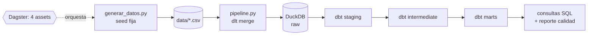

# Informe técnico: pipeline analítico de un minimercado

## 1. Arquitectura

El flujo es lineal y cada etapa tiene un único responsable. **`generar_datos.py`** simula 100 días de operación con una semilla fija (42) y escribe cinco CSV. **`pipeline.py`** los carga con `dlt` en el esquema `raw` de `data.duckdb`; cada recurso usa `write_disposition="merge"` con clave primaria `id`, de modo que reejecutar no duplica filas. **dbt** transforma en tres capas (vistas en staging e intermediate, tablas en marts). **Dagster** expone los pasos como cuatro assets encadenados (`generar_datos_asset → ingesta_dlt_asset → dbt_transformations_asset → reporte_calidad_asset`), ejecutables desde la interfaz o con `dagster asset materialize`. DuckDB se eligió por ser un archivo local sin servidor, ideal para reproducir el trabajo en cualquier equipo.

## 2. Decisiones de modelado y calidad

- **Simulación coherente.** El generador avanza día a día: repone stock cuando baja de un umbral, registra mermas de perecederos y genera ventas con demanda distinta por día de semana, por producto y una leve tendencia creciente. Cada compra, venta y merma produce su movimiento de stock, por lo que el stock nunca es negativo. Un vendedor ingresa a mitad del período y solo vende después de su alta.
- **Capas.** Staging castea tipos y normaliza nombres (`producto_id`, `fecha_venta`, importes con `decimal`). Intermediate une ventas con producto y vendedor (`int_ventas_enriquecidas`) y calcula el stock acumulado con una función de ventana (`int_movimientos_stock`). Marts responden preguntas concretas de negocio.
- **Calendario completo.** `mart_ventas_diarias` incluye todos los días del período, incluso sin ventas, para no sesgar promedio, mediana y desviación estándar.
- **Definiciones explícitas.** Ganancia bruta = ingreso neto − cantidad × costo de catálogo. Rotación = unidades vendidas / stock promedio. Punto de reposición = venta diaria de los últimos 30 días × (7 días de entrega + 3 de seguridad), parametrizable con `vars` de dbt. La clasificación ABC usa el acumulado *previo* al producto (A < 80 %, B < 95 %), así el producto que cruza el umbral queda en la clase superior.
- **Calidad en tres niveles.** (1) `schema.yml` con `not_null`, `unique`, `relationships` y `accepted_values`; (2) cinco pruebas singulares de negocio (importes positivos, stock no negativo, ventas posteriores al alta, conciliación de ingresos entre marts, participación ABC = 100 %); (3) `reporte_calidad_asset`, que valida volúmenes, duplicados y conciliaciones y hace fallar el asset si algo no cuadra. En total, `dbt build` ejecuta 78 nodos sin errores, y `pytest` cubre reproducibilidad, esquema, idempotencia y una prueba de punta a punta.

## 3. Hallazgos

**Descriptivo.** Entre el 1/1 y el 10/4 de 2026 se registraron 1.792 ventas y 4.245 unidades, con una facturación neta de 6.774,05 y una ganancia bruta de 2.788,60 (margen del 41,2 %). Las ventas diarias promedian 67,74, con mediana 66,73 y desviación estándar 18,83 (coeficiente de variación 27,8 %); el rango va de 33,52 a 115,15. El promedio y la mediana son casi iguales, lo que indica una distribución bastante simétrica. El sábado factura en promedio 89,96 frente a 52,56 el martes: el fin de semana concentra la demanda. Un 23,8 % de las líneas lleva descuento, que cuesta apenas el 2,0 % del ingreso bruto.

**Rentabilidad.** Pan de molde (366,14) y Gaseosa cola 2L (360,40) lideran la ganancia bruta. Por categoría, snacks (45,6 %) y bebidas (44,1 %) tienen los mejores márgenes; lácteos (36,3 %) y almacén (37,2 %) los peores.

**Inventario.** Cerveza (7,8), pan (7,7) y agua (7,1) rotan más; queso fresco (1,6) y café (2,1) rotan menos, con 65 y 39 días de stock. Seis productos están bajo su punto de reposición: agua (34 unidades contra 74 recomendadas), pan (22 contra 44), cerveza (21 contra 42), gaseosa, azúcar y yerba. El hallazgo clave es que la política de reposición simulada (comprar con unos 4 días de cobertura) es más corta que el plazo de entrega más el colchón (10 días), lo que expone a quiebres en los productos de mayor venta.

**Comercial.** Ana Gómez lidera con 1.756,20 (25,9 %), seguida de Luis Benítez (24,6 %); juntos suman el 50,6 %. Sofía Villalba, que ingresó el día 25, vende menos (10,3 %) simplemente por tener menos días activos, por lo que conviene comparar ventas por día trabajado. La sucursal Centro aporta el 60,9 % del ingreso. En la clasificación ABC, 11 productos (55 %) generan el 80,2 % del ingreso, 6 (30 %) el 15,4 % y 3 (15 %) el 4,4 %.

## 4. Limitaciones y mejoras

- **Datos sintéticos.** Los patrones salen de reglas simples: sin estacionalidad mensual, promociones, precios cambiantes ni correlación entre productos. El Pareto resulta suave (el 55 % de los productos es clase A) porque la demanda se simuló poco concentrada.
- **Costo.** Se usa el costo de catálogo y no el costo promedio ponderado de las compras reales, lo que simplifica el margen. Una mejora es valorizar el inventario con PEPS o costo promedio.
- **Una línea por venta.** No existe el concepto de ticket con varios productos, así que no se puede hacer análisis de canasta.
- **Quiebres no observados.** Las ventas perdidas por falta de stock no se registran; la demanda real podría ser mayor.
- **Ingesta.** El `merge` evita duplicados pero no elimina filas que desaparezcan del origen; una carga incremental con `replace` periódico o borrado lógico lo resolvería.
- **Escalabilidad y operación.** DuckDB admite un solo escritor. Para producción convendría un warehouse compartido, `dbt docs`, alertas de Dagster y ejecución programada con sensores o *schedules*.
