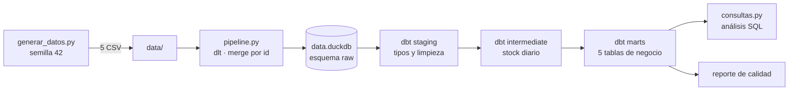

# Informe técnico: Pipeline analítico de un minimercado

**Equipo:** tp-data-G5

**Integrantes:** mjgo139 (Ingeniería de Datos) · fabioAlfonsoUNC (Analytics Engineering) · celso2000 (Orquestación y QA)

**Fecha:** 07/11/2026

## 1. Arquitectura

Cada etapa es un asset de Dagster que depende de la anterior (`generar_datos_asset` → `ingesta_dlt_asset` → `dbt_transformations_asset` → `reporte_calidad_asset`), y el job `pipeline_completo` las ejecuta en orden.

1. **Generación.** `generar_datos.py` simula 92 días (1 de julio al 30 de septiembre de 2026) de un minimercado con 20 productos y 5 vendedores en dos sucursales. Descuenta del stock lo vendido y repone los lunes y jueves, así compras, ventas y movimientos son coherentes. Con la semilla 42 los archivos salen idénticos en cada ejecución.
2. **Ingesta.** `pipeline.py` define una fuente dlt con un recurso por CSV y los carga en `data.duckdb`, esquema `raw`. Cada recurso usa `merge` con `primary_key="id"`, así reejecutar la ingesta no duplica registros.
3. **Transformación.** dbt organiza los modelos en tres capas y en tres esquemas con el mismo nombre: `staging`, `intermediate` y `marts`.
4. **Calidad.** `dbt build` corre 41 pruebas, y el último asset hace seis controles más sobre la salida final.

## 2. Decisiones de modelado y calidad de datos

**Capa raw en texto.** dlt carga los CSV tal como vienen, en texto. El casteo de tipos ocurre en staging, en un solo lugar visible.

**Staging.** Cada modelo `stg_` convierte fechas, enteros y decimales, renombra `id` a una clave explícita (`venta_id`, `producto_id`) y calcula importes derivados: `importe_bruto`, `monto_descuento` e `importe_neto` en ventas, y `costo_total` en compras.

**Intermediate.** `int_movimientos_stock` cruza cada producto con cada día y calcula el stock al cierre con una suma acumulada de entradas menos salidas. Se calcula desde compras y ventas, y una prueba SQL comprueba que coincide con la tabla de movimientos.

**Marts.** `mart_ventas_diarias` resume cada día; `mart_rentabilidad_productos` calcula la ganancia bruta con un costo promedio ponderado entre el stock inicial y todas las compras; `mart_rotacion_inventario` obtiene rotación, días de stock y punto de reposición; `mart_desempeno_vendedores` acumula las ventas por vendedor; y `mart_clasificacion_abc` ordena los productos por facturación. El punto de reposición equivale a 7 días de demanda (4 días entre pedidos más 3 de seguridad) y se configura con la variable `dias_cobertura`.

**Pruebas de calidad.** Los `schema.yml` declaran `unique`, `not_null`, `relationships` entre ventas, compras, productos y vendedores, y `accepted_values` para descuentos, tipos de movimiento y clases ABC. Además escribimos cuatro pruebas SQL propias: el stock nunca es negativo, el stock calculado coincide con los movimientos, los importes son positivos y la clasificación ABC suma 100 %. En `pytest` probamos la reproducibilidad con la semilla, los volúmenes y claves de los CSV, el esquema en DuckDB tras la ingesta, la idempotencia y el flujo completo de punta a punta.

## 3. Hallazgos

**Descriptivo.** En los 92 días se registraron 7.577 líneas de venta y 11.681 unidades, con una facturación neta de Gs. 128.030.065.

| Indicador de venta diaria | Valor (Gs.) |
| --- | ---: |
| Promedio | 1.391.631 |
| Mediana | 1.333.210 |
| Desviación estándar | 227.195 |
| Mínimo | 1.031.550 |
| Máximo | 2.137.450 |

La mediana queda por debajo del promedio porque los fines de semana elevan la media: el sábado se factura en promedio Gs. 1.815.468, un 58 % más que el lunes (Gs. 1.147.752). Los descuentos representaron apenas el 1,2 % de la facturación bruta.

**Rentabilidad.** La ganancia bruta total fue de Gs. 37.476.522, un margen del 29,3 %. La yerba mate aporta la mayor ganancia (Gs. 3.739.867), seguida por la gaseosa cola y la chipa. La chipa también tiene el mejor margen (38,1 %), y la leche entera, el más bajo (25,1 %).

**Inventario.** Al 30 de septiembre, 9 de los 20 productos estaban por debajo del punto de reposición. El caso más urgente es el queso Paraguay, con 8 unidades para un punto de 24, apenas 2,4 días de venta. Hubo 27 días-producto con stock en cero, es decir, ventas perdidas. Las galletitas (11,6) y la chipa (11,4) rotan más rápido; el detergente (4,0) y el jabón en polvo (4,2), más lento.

**Comercial.** La clasificación ABC muestra que 13 productos (clase A) concentran el 81,5 % de la facturación, 5 productos (B) el 14,8 % y 2 productos de limpieza (C) el 3,7 %. Ana Benítez lidera con el 29,5 % de las ventas, seguida por Carlos Giménez (21,3 %) y Lucía Ortiz (20,1 %). El ticket promedio por línea es casi igual entre vendedores (entre Gs. 16.761 y 17.059), así que la diferencia se explica por la cantidad de ventas atendidas y no por su valor. La sucursal Centro reúne el 63,6 % de la facturación.

## 4. Limitaciones y oportunidades de mejora

- **Datos sintéticos.** La demanda varía solo por día de la semana y por azar: no hay estacionalidad mensual, feriados, promociones ni cambios de precio.
- **Sin comprobante de venta.** Cada fila es una línea de venta y no una boleta, por eso el ticket promedio es por línea y no por cliente.
- **Supuestos de reposición.** Los pedidos llegan el mismo día en que se compran, siempre los lunes y jueves, y el punto de reposición usa una cobertura fija de 7 días para todos los productos.
- **Mejoras.** Carga incremental por fecha en dlt y dbt, un schedule diario en Dagster, identificadores de boleta y cliente, y un punto de reposición que considere la variabilidad de la demanda de cada producto.

## 5. Organización y uso de IA

Tres roles: generación e ingesta (Marcelo), dbt y análisis (Fabio), orquestación, pruebas y documentación (Celso). Se usó un asistente de IA para revisar y explicar el código; cada integrante ejecutó y verificó su parte.