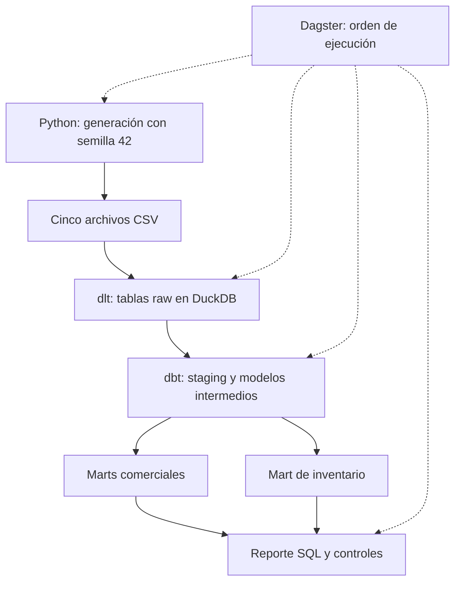

# Informe técnico: pipeline analítico de un minimercado

**Equipo:** `tp-data-Grupo-Johanna-Adalberto`. **Integrantes:** Deysi Pérez Lesmo (`johannaperez0422`) y Adalberto Cardozo  (`cardozogautoa-eng`).

## Arquitectura y reproducibilidad

El proyecto simula la operación de un minimercado durante 90 días consecutivos, del 1 de enero al 31 de marzo de 2026. Su propósito es mostrar cómo se pasa de registros operativos de compras, ventas y movimientos de almacén a indicadores que pueden ayudar a decidir qué productos reponer y cómo interpretar el desempeño comercial. Todos los nombres y valores son ficticios. Los importes se expresan en guaraníes simulados.

El diagrama muestra dónde se conserva cada resultado. Python genera los archivos, dlt los carga y DuckDB mantiene los datos en un archivo local. dbt transforma las tablas de origen y construye vistas y tablas de consulta. Las ramas de análisis comercial e inventario se reúnen en el reporte. Dagster ejecuta las etapas con dependencias explícitas: si falla la carga o una prueba de dbt, el reporte final no se produce en esa corrida.

El generador fija la semilla y la fecha inicial. Asigna más demanda a ciertos productos y aumenta el número de ventas de fin de semana. Cada compra y cada venta se relaciona con un movimiento de almacén. Si las existencias no alcanzan para una venta simulada, el generador registra primero una compra de reposición. Así, las cantidades de los movimientos y las operaciones se pueden contrastar, y los saldos nunca necesitan ser negativos para completar la simulación.

## Modelado y calidad

Se usan cinco recursos dlt, uno por archivo. Antes de cargar, el código valida las columnas y la unicidad del identificador, y convierte fechas, cantidades y descuentos al tipo previsto. Se eligió reemplazar las tablas de origen porque cada generación representa una instantánea completa. Con los mismos archivos, la segunda carga debe conservar los identificadores y los valores de negocio. La prueba de persistencia compara tanto los conteos como las filas de ventas; los metadatos de ejecución de dlt pueden cambiar.

La capa de staging normaliza textos y aplica tipos explícitos. En la capa intermedia se concilian los movimientos con los documentos que los originaron, se calcula el saldo por producto y se valoran las ventas. El costo unitario se estima mediante un promedio ponderado que combina las unidades de apertura con las compras del período. La ganancia bruta es la facturación después de descuentos menos el costo asignado a las unidades vendidas. El cálculo utiliza el costo promedio del período completo, por lo que el resultado debe interpretarse como una estimación retrospectiva.

Las pruebas de dbt verifican valores obligatorios, identificadores únicos y referencias entre tablas. También comprueban que cada movimiento tenga una compra o venta concordante, que no se repita el movimiento de un documento y que no existan saldos negativos. El reporte contrasta la facturación total con los acumulados por producto y vendedor. Las tres pruebas de pytest cubren generación reproducible, carga repetida y ejecución integral. La corrida verificada completó 13 modelos y 50 pruebas de datos de dbt.

## Resultados de la simulación

La ejecución generó 20 productos, 5 vendedores, 181 compras, 788 registros de venta y 969 movimientos de almacén. Se vendieron 1.738 unidades. La facturación neta de descuentos alcanzó Gs. 14.325.225 y la ganancia bruta estimada fue de Gs. 3.384.154,51. La media diaria fue de Gs. 159.169,17, la mediana de Gs. 142.787,50 y la desviación estándar poblacional de Gs. 65.661,17. Se utilizó la medida poblacional porque el resumen describe todos los días de la simulación. La diferencia entre media y mediana, por sí sola, no permite establecer la forma de la distribución.

El vendedor 05 registró la mayor facturación, con Gs. 3.236.200. El azúcar alcanzó la mayor ganancia bruta estimada por producto, con Gs. 445.404,35. La clasificación ABC se calculó por unidades vendidas, ordenando de mayor a menor y usando cortes acumulados de 80 % y 95 %. La clase A reunió 12 productos y 1.467 unidades, aproximadamente el 84,4 % del total. Supera el primer corte porque el producto que lo cruza se conserva en esa clase.

Para inventario, la rotación relaciona el costo de las ventas con el inventario promedio valorizado. Los días disponibles dividen el stock final por la demanda media diaria. El punto de reposición se fijó en nueve días de demanda esperada, como supuesto de siete días de plazo y dos de reserva. El jabón terminó con 7 unidades, por debajo del umbral de 10, y con 6,92 días estimados de cobertura.

## Aportes y verificación

Deysi Pérez organizó  los archivos y los commits del proyecto, ejecutó el flujo en Codespaces y comprobó que Dagster lo completara. Utilizó ChatGPT/Codex como apoyo para interpretar la consigna del trabajo, así también los materiales del moodle como los videos de las clases, preparó el código y las pruebas, revisó además los cálculos y por último la redacción de la documentación. A partir de los CSV publicados volvió a calcular las unidades vendidas y la facturación neta, y se comprobó la correspondencia entre cada compra o venta y su movimiento de stock. Al momento de elaboración de este informe, las validaciones asignadas a Adalberto Cardozo no se habían incorporado aún a la rama del equipo 

## Limitaciones y mejoras

Los resultados describen un escenario generado, por lo que no se pueden generalizar a un comercio real. Los vendedores fueron asignados al azar; el ranking refleja esta simulación y no mide productividad individual. El costo promedio de todo el período tampoco permite reconstruir el costo exacto de cada venta en su fecha. Una extensión útil sería incorporar costos móviles, devoluciones, ventas por comprobante, variaciones de plazo por proveedor y una reserva calculada a partir de la demanda observada. Estos cambios permitirían evaluar si la regla de reposición sigue siendo adecuada cuando cambian las condiciones del negocio.
