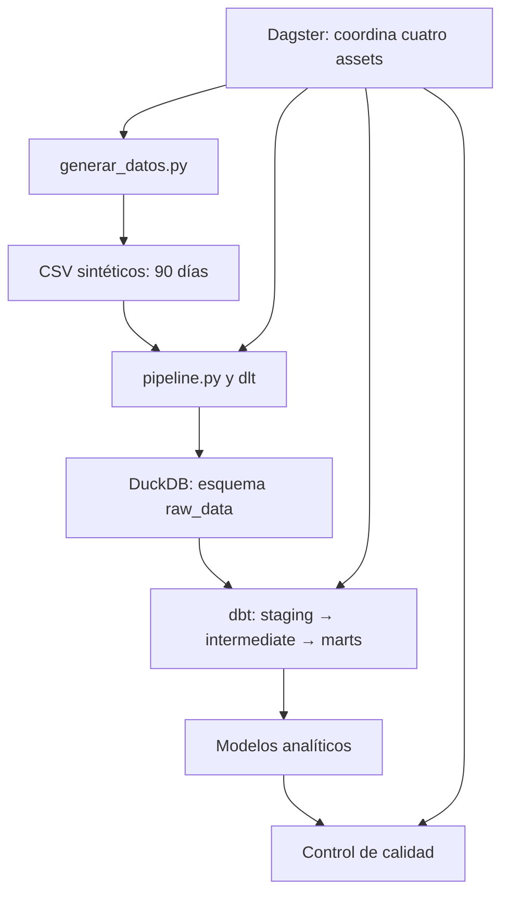

# Informe Técnico y Documentación
### Explicación del diagrama de arquitectura

Dagster coordina cuatro assets: generación de datos, ingesta, transformación y control de calidad. La secuencia comienza con generar_datos.py, que produce archivos CSV sintéticos para un periodo de 90 días. Después, pipeline.py utiliza recursos de dlt para leer esos archivos y cargarlos en DuckDB, dentro del esquema raw_data. A continuación, dbt transforma las tablas crudas en modelos organizados por capas. Finalmente, el asset de calidad comprueba que las tablas requeridas existan y tengan registros.

El diagrama representa tanto el recorrido de los datos como la función de Dagster como orquestador. Si una etapa falla, la ejecución permite identificar el asset involucrado. En la ejecución observada, Dagster completó los cuatro assets y el run finalizó con estado Success.
### Principales decisiones de modelado analítico y calidad de datos
Los datos originales se mantienen en raw_data y se separan por entidad: productos, vendedores, compras, ventas y movimientos de stock. Esta decisión conserva una capa de origen que puede compararse con los modelos transformados. Los recursos de dlt usan la disposición replace; por ello, al cargar nuevamente los CSV, las tablas de origen se reemplazan y no acumulan filas de ejecuciones anteriores.

El proyecto dbt se divide en staging, intermediate y marts. Staging prepara los campos de origen; intermediate reúne o enriquece la información necesaria para los cálculos; y marts organiza los resultados para consultas analíticas. Entre los modelos finales se encuentran ventas diarias, estadísticas de ventas, rentabilidad de productos, rotación de inventario, desempeño de vendedores y clasificación ABC. Esta separación facilita mantener la lógica y revisar cómo se construye cada indicador.

La calidad se controla con pruebas de dbt, validaciones del asset de Dagster y pruebas de Python. El asset de calidad comprueba la existencia y el contenido no vacío de las tablas esperadas. test_pipeline.py comprueba que la lectura de un CSV produzca diccionarios con los valores correctos y que la búsqueda de un archivo inexistente genere FileNotFoundError. En la ejecución registrada, dbt informó 67 resultados aprobados, sin advertencias ni errores; las pruebas de Python finalizaron con 2 pruebas aprobadas.
### Resumen de hallazgos estadísticos y comerciales obtenidos
Para los 90 días del conjunto sintético, mart_estadisticas_ventas registra una facturación neta total de 3.366.422,50 unidades monetarias, 2.423 unidades vendidas y una ganancia bruta de 1.307.222,50. La relación entre ganancia bruta y facturación neta equivale aproximadamente a un margen de 38,83 %. La facturación neta diaria promedio es 37.404,69, y la mediana, 38.101,25. La desviación estándar es 15.434,27; el mínimo diario observado es 10.950,00 y el máximo, 77.482,50. La diferencia entre mínimo y máximo muestra variación entre días, pero no identifica por sí misma sus causas.

En la salida consultada de la clasificación ABC aparecen 20 productos. El queso cremoso de 500 g registra facturación neta de 430.500, ventas de 124 unidades y participación de 12,79 %; figura en la clase A. Este indicador ayuda a distinguir productos con mayor contribución a la facturación del periodo.

El modelo de vendedores contiene cinco registros. Carlos Gómez ocupa el primer lugar del ranking, con 138 transacciones, facturación neta de 744.012,50 y participación de 22,10 %. Sofía Martínez figura en segundo lugar, con 153 transacciones, facturación de 741.337,50 y participación de 22,02 %. La comparación muestra que un mayor número de transacciones no implica necesariamente una facturación total mayor.

En rotación de inventario, la fila consultada de cerveza Pilsen de 1 L registra 3 unidades disponibles frente a un punto de reposición de 11,5, y una cobertura estimada de 1,8 días. El campo bajo_punto_reposicion está marcado como verdadero, señal de reposición en el escenario simulado. La base también contiene 674 filas de ventas, 115 de compras, 809 de movimientos de stock, 20 productos y 5 vendedores; el modelo de ventas diarias tiene 90 filas.
### Limitaciones del conjunto de datos y oportunidades de mejora
Los datos son sintéticos y cubren solo 90 días, con 20 productos y 5 vendedores. Por tanto, sirven para probar el flujo técnico, pero no describen necesariamente el comportamiento de un minimercado real ni permiten generalizar tendencias comerciales. Las variaciones de facturación no indican si hubo promociones, cambios de precios, días festivos, problemas de abastecimiento u otras causas. Los importes se presentan en las unidades monetarias generadas por el conjunto; estos resultados no deben interpretarse como registros contables reales.

Como oportunidades de mejora, se puede ampliar el periodo y la variedad de productos, incorporar escenarios de promociones y faltantes, y contrastar los resultados con datos reales anonimizados. También conviene agregar controles explícitos de tipos, valores permitidos, unicidad y relaciones entre identificadores; y generar alertas para productos bajo el punto de reposición. Documentar la unidad monetaria y las fórmulas de cada indicador facilitaría interpretar y reproducir el análisis. Así, la arquitectura actual queda preparada para pasar de una demostración reproducible a un análisis más completo, siempre que se incorporen datos adecuados y controles adicionales.